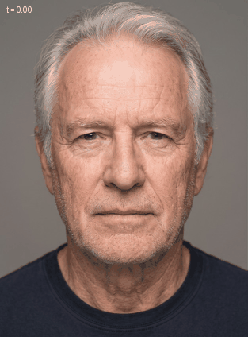
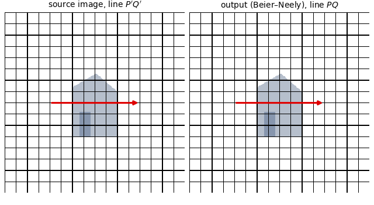
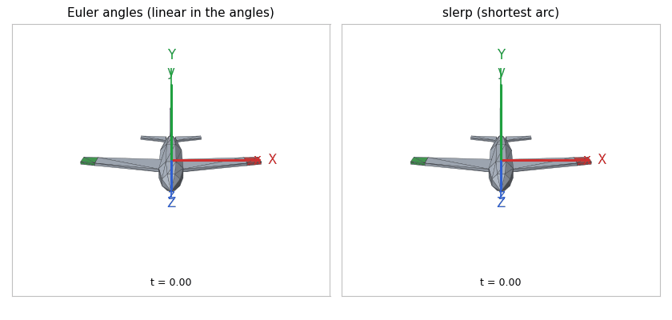
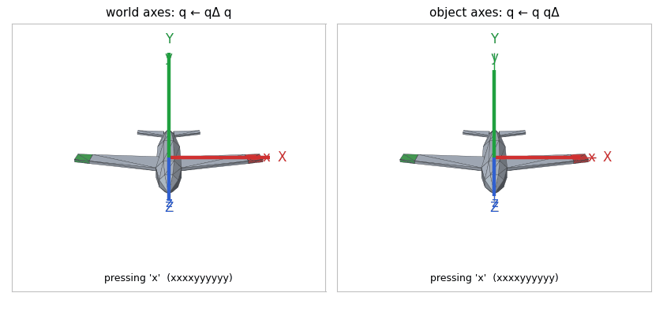
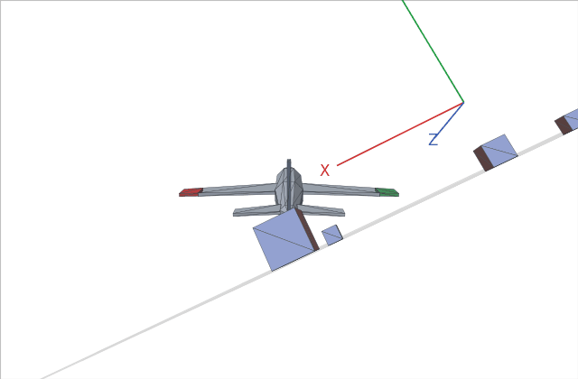

<h1 align="center">Feature-Based Warping &amp; 3D Viewing</h1>

<p align="center">
  Image warping and morphing with feature lines (Beier–Neely), and the full 3D viewing pipeline
  with Euler angles, quaternions and slerp, written from scratch with <b>NumPy only</b>.
</p>

<p align="center">
  
  
  
  
</p>

<p align="center">
  
  &nbsp;&nbsp;
  
</p>
<p align="center"><sub>
  Left: a morph between two portraits, computed from 12 matching feature lines.
  Right: one feature line translating, rotating and doubling in length, and the warp it defines.
</sub></p>

---

## Overview

The project has two halves, both built on the same idea: understand the maths by implementing it, with no library doing the
interesting part (no `cv2.remap`, `findHomography`, `scipy.spatial.transform`, …).

| | Topic | What is implemented |
|---|---|---|
| **A** | Warping and morphing | Beier–Neely feature-line warp, two-image morph, least-squares affine fit, homography estimation, backward warping by a 3×3 matrix |
| **B** | 3D viewing | 4×4 transforms, axis-angle and Euler rotations, quaternions and slerp, `look_at`, orthographic and perspective projection, viewport, reverse pipeline (`pixel_ray`), chase camera |

Everything is vectorized: a 256×256 colour warp with one feature line takes about 30 ms, which keeps the interactive
tools responsive.

## Part A: warping and morphing

The Beier–Neely method defines a warp by pairs of corresponding line segments. Each pair gives every output pixel a source
position; the final position is a weighted average over all lines, with weights `(length^p / (a + dist))^b`.

<p align="center">
  
</p>

- `source_positions`, `warp_lines`: the warp itself, with bilinear or nearest-neighbor sampling
- `morph`: warp both images to the interpolated lines, then cross-dissolve
- `fit_affine`, `fit_homography`, `warp_matrix`: global maps from point correspondences, for comparison with the line-based warp

## Part B: 3D transformations and viewing

### Euler angles vs. slerp

Interpolating the three Euler angles linearly does not follow the shortest rotation, while slerp on quaternions does.

<p align="center">
  
</p>

### Rotating about world axes vs. object axes

The same key presses (`x` four times, then `y` six times) give different results depending on the order of the quaternion
product: `q ← q_Δ q` turns about the fixed world axes, `q ← q q_Δ` about the airplane's own axes.

<p align="center">
  
</p>

### Chase camera

`chase_view` builds the view matrix of a camera that rides behind and above the airplane: the airplane stays fixed in the image
and the world moves around it.

<p align="center">
  
</p>

## Getting started

```bash
pip install numpy matplotlib

python warptool.py                           # interactive feature-line warp tool
python warptool.py morph_a.jpg morph_b.jpg   # morph between two images
python viewer.py                             # interactive 3D airplane viewer
python viewer.py --key1 180,180,180          # keyframes for the interpolation demo
```

The tools open a window, so run them on a desktop machine (not Colab/Jupyter). On Linux you may need `sudo apt install python3-tk`.

### Tests

```bash
python test_partA.py      # 37 checks: Beier–Neely, fits, warps, morph, speed
python test_partB.py      # 93 checks: transforms, quaternions, slerp, cameras, pixel_ray, chase_view
python selftest.py        # the course's convention checks
```

### Regenerating the GIFs

```bash
python docs/make_gifs.py           # headless; writes docs/*.gif from the code in ex2.py
```

## Experiments and write-up

The `report/` folder holds the LaTeX source of the write-up (`pdflatex report.tex`): for every experiment a prediction made
before running it, the measured result, and an explanation. A few findings:

- With **one** feature line the parameters `a`, `b`, `p` cancel out of the weighted average, so they have no effect; they matter
  from two lines on.
- Shrinking an image by about 3.6× with single-point sampling **skips thin grid lines** (aliasing), and bilinear sampling does not fix it.
- At `ay = 90°` the Euler angles reach **gimbal lock**: two sliders turn about the same axis and a roll about the nose cannot be produced
  by small changes of the angles.
- For a pair of orientations that are in fact the same, slerp stays still while the Euler interpolation tumbles away and back.
- Three images of the airplane drawn with a single error each were traced to `perspective` (sign of `w`), `look_at` (order of the cross
  product) and `viewport` (missing y flip); `repro_bugs.py` reproduces them.

## Project layout

| Path | Purpose |
|---|---|
| `ex2.py` | The implementation: all Part A and Part B functions |
| `test_partA.py`, `test_partB.py` | My own tests for the two parts |
| `repro_bugs.py` | Plants one error in a function to reproduce the three bug images |
| `docs/` | README GIFs and the script that generates them |
| `report/` | LaTeX source of the experiment report and its figures |
| `my_images/` | Output of the warp tool's "save frames": images, feature lines and morph frames |
| `warptool.py`, `viewer.py`, `meshes.py`, `selftest.py`, `bugs/` | Interactive tools, meshes and images provided by the course |
| `ex2_template.py` | The original course template, kept for reference |

## Conventions

- Images are float arrays in `[0, 1]`; pixel `(row, col)` is centered at `(x, y) = (col, row)`; warping is backward
- 3D transforms are 4×4 matrices acting on column vectors, so in `A @ B` the matrix `B` applies first
- Right-handed world and eye coordinates, the camera looks down `-z` (OpenGL style); NDC is the cube `[-1, 1]³`
- Raster `y` points down; quaternions are `[w, x, y, z]`; angles are in degrees

## Credits

The interactive tools (`warptool.py`, `viewer.py`, `meshes.py`, `selftest.py`), the sample images and the bug images were provided
by the course staff. The warp method follows Beier and Neely, *Feature-Based Image Metamorphosis*, SIGGRAPH 1992.

This is a coursework project shared as a portfolio piece. If you are taking the course, please write your own implementation.
